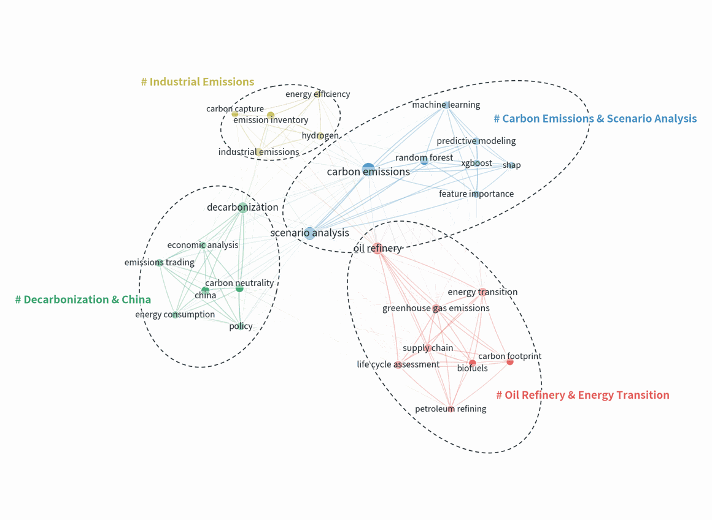

# SciMap-Agent

**Local, reproducible bibliometric mapping and journal-style keyword visualization**  
**Release candidate: v0.4.3 · Python 3.10+ · MIT License**

[简体中文说明 / Chinese README](README_CN.md) · [Install](docs/INSTALLATION.md) · [Data formats](docs/DATA_FORMATS.md) · [Methods and limitations](docs/METHODS.md) · [Figure guide](docs/FIGURES.md) · [Changelog](CHANGELOG.md)

SciMap-Agent imports bibliographic metadata, builds **document-level keyword co-occurrence** networks, detects communities, and exports presentation-/manuscript-oriented figures and auditable tables. It includes a Windows file picker, a command-line interface, and an optional Codex Agent Skill. Analysis runs locally; no cloud AI service is required.



*The figure above uses **fabricated sample records**. It demonstrates the visual style, not a scientific result.*

## What it does

| Capability | Result |
|---|---|
| Read metadata | Zotero CSV, Web of Science tagged TXT/CIW/WOS, Scopus CSV, RIS; a recognized grouped XLSX literature workbook |
| Normalize records | DOI/title deduplication, configurable synonyms and stopwords, partial Zotero tag filtering |
| Quantify terms | Document-level frequencies, Top 10 tables, keyword-by-year counts |
| Build a network | Weighted co-occurrence, greedy-modularity communities, ForceAtlas2 layout with spring fallback |
| Draw figures | Cluster network, publication-year overlay, density map, yearly term heatmap, custom cluster timeline; optional two-panel overlay for recognized grouped workbooks |
| Export | **600-dpi PNG, SVG, PDF** for the figure types; CSV/JSON/Markdown and VOSviewer-compatible map/network files |
| Integrate Codex | Project-local `.agents/skills/scimap-agent/SKILL.md` |

**Please note:** This software is a *beta research tool*, not a replacement for CiteSpace or VOSviewer. Its cluster timeline and heatmap are custom visualizations, **not** CiteSpace native burst detection. It does not currently perform co-citation, bibliographic coupling, or a systematic-review screening process.

## Quick start on Windows

1. Install **Python 3.11** from [python.org](https://www.python.org/downloads/). Enable the Python launcher during setup.
2. Download/extract the source repository or clone it.
3. Double-click **`Install-SciMap-Agent.bat`** (Internet connection needed for the first install).
4. Double-click **`Start-SciMap-Agent.bat`**, select one or more bibliography exports, then choose an output folder.
5. Open the output folder. Ordinary exports produce `figures/`, `tables/`, `vosviewer/`, and `reports/`. A recognized five-group XLSX workbook instead produces numbered group directories and `comparison/`.

The Windows file picker is a PowerShell interface, **not a standalone `.exe`**. Its behavior should be confirmed on your own Windows machine; CI currently tests the Python analysis core.

### Command line (Windows PowerShell)

Run these commands **from the repository root** so the default `config/` paths resolve correctly:

```powershell
py -3.11 -m venv .venv
.\.venv\Scripts\python.exe -m pip install -e .
.\.venv\Scripts\scimap.exe analyze --input "D:\papers\export.csv" --output "D:\papers\scimap-results"
```

Cross-platform equivalent (after installing with `python -m pip install -e .`):

```bash
scimap analyze --input data/sample/synthetic_wos.txt --output outputs/demo --min-occurrences 2
```

### With a grouped Excel workbook

```bash
scimap analyze --input "data/raw/merged_literature.xlsx" --output outputs/study --min-occurrences 5
# To supplement missing abstracts and author/index keywords with a separate export:
scimap analyze --input "data/raw/merged_literature.xlsx" --enrich-with "data/raw/full_metadata.csv" --output outputs/enriched
```

The program recognizes **specific five-category column flags**, not arbitrary Excel worksheets. Classification groups may overlap, so do not sum their counts. Detailed format requirements: [Data formats](docs/DATA_FORMATS.md).

### Codex Agent Skill

Open the repository root in Codex and request:

```text
$scimap-agent
Analyze my bibliography export using the default journal-cluster style.
Save keyword maps, Top 10 frequency tables, temporal figures, SVG/PDF and a methods report.
Distinguish supplied author keywords from terms inferred from titles/abstracts.
```

The Skill orchestrates the same local CLI; **Codex is optional**. It does not automatically connect to CiteSpace or VOSviewer via MCP.

## How to read the figures

- **Node size:** the number of documents containing a keyword (not the raw number of text mentions).
- **Edge:** a pair of terms occurring in the same document; width corresponds to co-occurrence weight. Curved paths and cluster boundaries are visual choices.
- **Cluster color:** algorithm-detected community membership, not necessarily a validated academic discipline.
- **Overlay color:** average publication year for documents containing a term. In the two-panel overlay, the legend is fixed to 2016–2026 at two-year intervals for consistent comparison; values outside this range are color-clipped.
- **Cluster timeline:** annual occurrence of representative terms in the detected clusters, **not** CiteSpace's time-zone, burst, or native timeline algorithm.
- **Heatmap:** annual *document counts* for the most frequent selected terms, not publication totals for a field.

More: [Figure and output reference](docs/FIGURES.md) and [Methods](docs/METHODS.md).

## Defaults and reproducibility

- **PNG:** 600 dpi; **PDF/SVG:** vector formats with live text where the font and renderer support it.
- **Fonts:** English labels prefer *Times New Roman* if installed; on Linux/macOS a Times-like serif fallback may be used. Exact TNR appearance requires installing it on your machine; no font files are redistributed.
- **Frequency:** default `auto` is approximately 2% of input records for ordinary files (minimum 2). Recognized grouped workbook comparisons use threshold 5 unless overridden; smaller groups under 50 records are drawn at threshold 2 for exploratory comparison. Always report sensitivity to thresholds.
- **Term provenance:** when original author/index keywords cover enough records, those are used; otherwise transparent controlled vocabulary terms are inferred from titles or titles+abstracts. **Never report extracted title terms as author keywords.**
- **Software:** NetworkX greedy modularity, ForceAtlas2 or spring fallback; the code does not replicate CiteSpace/VOSviewer proprietary methods.

Results should be reviewed before submitting to a journal. High resolution does not alone establish scientific validity, unambiguous cluster labels, or absence of overlapping text.

## Source layout

```text
src/scimap_agent/         # importers, term extraction, network analysis, plotting, CLI
config/                   # stopwords, thesaurus, controlled-term patterns
.agents/skills/scimap-agent/ # Codex Skill and technical references
data/sample/              # entirely synthetic bibliography examples
docs/                     # installation, input formats, methods and figures
.github/workflows/        # Python test workflow
tests/                    # automated tests
```

## Privacy and license

Do **not** upload exported personal Zotero libraries, proprietary/unpublished materials, PDFs, or study-specific raw datasets to a public GitHub repository. The public source release should include only code, documentation and synthetic examples. Analyses are local and source exports are not sent to a third-party service by SciMap-Agent itself.

MIT License — see [LICENSE](LICENSE). Third-party packages retain their respective licenses. Contributions and issues are welcome; when reporting parser defects, attach a **minimal anonymized or synthetic reproduction** rather than an entire private bibliography.
