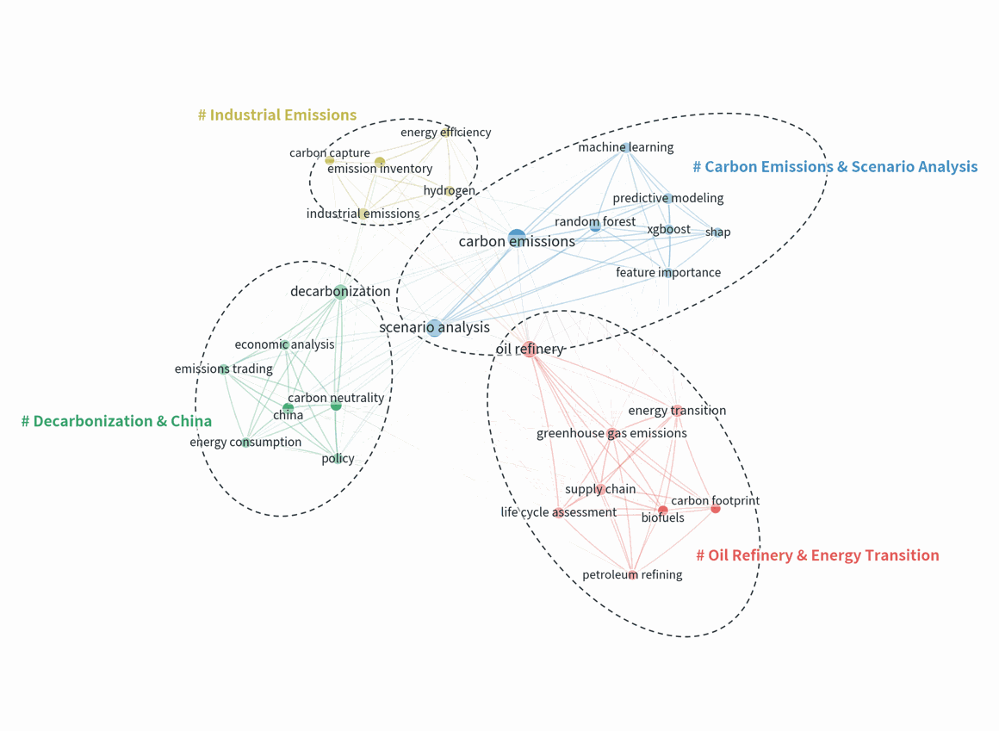

# SciMap-Agent：文献计量分析与科研知识图谱自动绘制工具

**v0.4.3 测试版 · Python 3.10+ · MIT 开源许可证**

[English README](README.md) · [安装说明](docs/INSTALLATION.md) · [输入格式](docs/DATA_FORMATS.md) · [方法与局限](docs/METHODS.md) · [图表解读](docs/FIGURES.md) · [更新日志](CHANGELOG.md)

SciMap-Agent 是一套**本地运行**的文献计量分析工具。导入 Web of Science、Scopus、Zotero、RIS 文献导出文件，或符合特定结构的五类文献 Excel 汇总表后，可以自动统计高频术语、建立关键词共现网络、检测聚类、绘制时间图，并导出高分辨率图件及研究方法报告。可直接运行，也可通过 Codex Skill 调用。



*说明：示例图来自虚构文献，供展示图形风格使用，不代表真实科研结论。*

## 主要功能

| 功能 | 输出与用途 |
|---|---|
| 文献元数据导入 | Zotero CSV、WoS TXT/CIW/WOS、Scopus CSV、RIS、指定结构的五类 XLSX 文献表 |
| 数据清洗 | DOI/题名去重、术语同义词归并、停用词过滤、部分 Zotero 自定义标签识别 |
| 频次统计 | 高频术语、Top 10 排名、逐年关键词文献数 |
| 关键词网络 | 按“同篇共现”建网，社区检测、聚类标题、节点与连线权重 |
| 时序图表 | 平均年份叠加图、年度热力图、自定义聚类时间线、部分分组 Excel 的 A/B 双面板图 |
| 导出 | **600 dpi PNG、PDF、SVG**；CSV 数据表、Markdown 分析报告、VOSviewer 兼容文件 |
| AI 工作流 | 项目内置 Codex Agent Skill，但不依赖 Codex 才能运行 |

**方法边界：** 本工具不是 CiteSpace、VOSviewer 的完整替代品。绘制的聚类时间线图是自定义的逐年统计图，**不等于 CiteSpace 原生时间线或突现分析**；目前不提供完整共被引、文献耦合和文献筛选审查功能。

## Windows 三步使用

1. 安装 **Python 3.11**（建议安装 Python Launcher），下载或克隆项目，并解压到英文路径或易于访问的文件夹。
2. 双击 **`Install-SciMap-Agent.bat`**，安装 Python 依赖；首次安装需要联网。
3. 双击 **`Start-SciMap-Agent.bat`**，在弹出的文件选择窗口中选择文献导出文件及结果文件夹。程序自动分析，不必手动设定每张图的节点配色。

Windows 启动器是 PowerShell 文件选择窗口，不是编译的 EXE；跨设备 Windows 图形运行仍需用户实际验证。Python 核心逻辑有自动化测试。

也可以在项目根目录运行命令：

```powershell
py -3.11 -m venv .venv
.\.venv\Scripts\python.exe -m pip install -e .
.\.venv\Scripts\scimap.exe analyze --input "D:\papers\wos_export.txt" --output "D:\papers\results"
```

如果导入的是符合五类研究标记的 XLSX，会生成 `01_...` 至 `05_...` 各组目录及 `comparison/` 总结目录；导入单一普通文献文件时，输出位于 `figures/`、`tables/`、`reports/` 和 `vosviewer/` 中。

## Excel 是否必须有摘要、关键词？

不必须，但需要区分**分析对象**：

- **有作者关键词/数据库关键词**：可进行标准的关键词共现统计。
- **没有关键词但有标题和摘要**：可以按受控词表提取“标题+摘要术语”；这不是作者关键词。
- **只有题名和年份**：仍可制作“标题术语”探索性网络、Top 10 及年度图，但不要将其描述成基于原文关键词的研究。
- **只有被自动分类的五类标签**：可以分组分析，但类别相互重叠且可能误分，正式论文应复核研究纳入标准。

如另有完整元数据导出，可补充原表缺失字段：

```powershell
.\.venv\Scripts\scimap.exe analyze --input "D:\papers\master.xlsx" --enrich-with "D:\papers\full_metadata.csv" --output "D:\papers\merged-results"
```

## 图件含义与风格

- **节点**：一个关键词/受控术语；大小表示包含该词的文献数。
- **连接线**：两个术语在同篇文献中共同出现；越粗通常代表共现次数越高。弧形路径只是视觉编码，不表示因果或发展方向。
- **不同聚类颜色**：根据 NetworkX 加权社区检测识别的主题组；自动标题由高频术语组合生成，投稿时应人工核查。
- **时间叠加色**：包含该词的文献平均发表年份。双面板图固定 2016、2018、2020、2022、2024、2026 刻度；超出区间的年份映射到色条端点。
- **关键词热力图**：每个年份包含该术语的文献数量。
- **聚类时间线**：代表词在逐年文献中的分布，并非 CiteSpace 原生聚类演化/突现图。

英文与数字优先使用 **Times New Roman**。如果设备没有该字体，程序可能回退至相近衬线字体；我们不会随项目分发商业字体文件。默认每类图导出 600 dpi PNG、可编辑的 SVG/PDF（具体文字可编辑程度取决于渲染环境）。

## Codex 使用

在 Codex 中打开项目根目录，然后输入：

```text
$scimap-agent
请分析我的文献导出文件，生成高频关键词排名、共现聚类图、
平均年份叠加图、热力图和方法报告，并保留 PNG、SVG、PDF。
注意区分作者原始关键词与从标题或摘要自动提取的术语。
```

**不需要 MCP 才能使用。** 这个版本包含 Agent Skill 和 Python 脚本，不宣称已经接通 CiteSpace 官方 MCP。

## 科研复现与局限

- 同一篇文献中同一词出现多次也只计 1 次，术语频次为“含该术语的文献数”。
- 共现网络不能证明因果关系；聚类会随着筛选标准、阈值和算法发生变化。
- 一般模式默认最低频次约为样本量 2%（至少为 2）；识别的五类 Excel 分析默认阈值 5，少于 50 篇的分组探索性采用阈值 2，必须在论文中注明。
- 2026 年可能是不完整年度；年度趋势不应简单解释为全年增长。
- 自动美化和 600 dpi 不等于“已经满足某期刊的排版审稿要求”，投稿前仍应核查标签遮挡、配色与数据依据。

完整解释见 [分析方法](docs/METHODS.md)。

## 隐私与开源

不建议把你自己的 Zotero 文献库、尚未发表的论文、完整 PDF、未经许可的版权文献或研究结果随源码发布。仓库只应包含源码、合成示例和使用文档。本工具默认在本地处理数据。

许可证：[MIT](LICENSE)。欢迎提交 Issue 或 PR，但错误复现请使用虚构/匿名数据。
